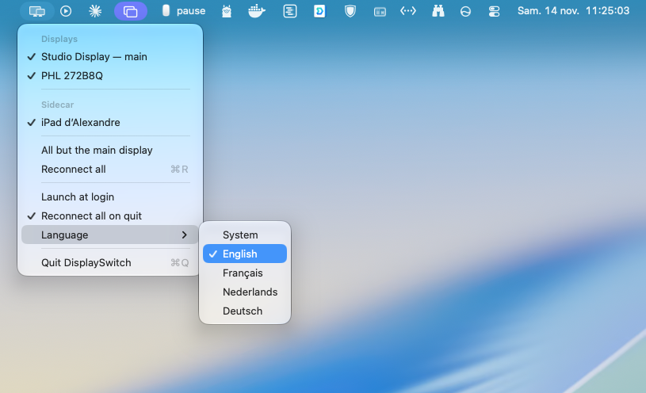

# DisplaySwitch

[](https://github.com/AlexandreBeauduin/DisplaySwitch/actions/workflows/ci.yml)

[English](README.md) · [Français](README.fr.md) · [Nederlands](README.nl.md) · **Deutsch**

Eine kleine macOS-Menüleisten-App (plus CLI), um Bildschirme zu verbinden / zu trennen —
**auch ein iPad, das als Sidecar-Bildschirm dient** — ohne ein Kabel zu ziehen.

> **Vibe coded.** Dieses Projekt entstand im Gespräch mit einem KI-Programmierassistenten
> (Claude Code): Der Mensch beschrieb das gewünschte Ergebnis, testete auf echter Hardware und
> steuerte; die KI untersuchte die macOS-APIs und schrieb Code und Doku. Es läuft auf dem
> Rechner des Autors; lies den Code, bevor du ihm auf deinem vertraust.

## Funktionen



- Listet Bildschirme und Sidecar-iPads auf, automatisch aktualisiert.
- Jeden einzeln über das Menü verbinden / trennen.
- **Alles außer Hauptbildschirm** trennen (iPads inklusive) / **Alle wieder verbinden**.
- Merkt sich, was es getrennt hat (ein getrennter Bildschirm verschwindet aus den Listen von macOS).
- Start bei der Anmeldung.
- Oberfläche auf **Englisch, Französisch, Niederländisch und Deutsch**: folgt der
  macOS-Sprache, oder im Menü wählen (*Sprache*).
- Sicherheit: trennt nie den letzten physischen Bildschirm, schützt den integrierten
  Bildschirm, verbindet beim Beenden alles wieder (Standard).

## Installation

**Download:** `DisplaySwitch-x.y.z.zip` von der Seite
[Releases](https://github.com/AlexandreBeauduin/DisplaySwitch/releases) laden, entpacken und
`DisplaySwitch.app` nach `/Applications` verschieben. Universal-Binary (Apple Silicon + Intel), macOS 14+.

**Aus dem Quellcode** (Xcode 16 oder neuer):

```bash
scripts/build-app.sh --install   # baut DisplaySwitch.app und kopiert sie nach /Applications
```

Eine heruntergeladene Kopie ist nicht mit einer Developer ID signiert: macOS blockiert sie
beim ersten Start → Systemeinstellungen › Datenschutz & Sicherheit › **Dennoch öffnen**.

## CLI

```bash
build/displayctl list
build/displayctl off <id>                 # --force erlaubt auch den integrierten Bildschirm
build/displayctl on <id>
build/displayctl sidecar off [name|uuid]  # iPad
build/displayctl sidecar on  [name|uuid]
build/displayctl on-all                   # Rettung: alles wieder verbinden, was wir getrennt haben
build/displayctl only-main                # alles außer dem Hauptbildschirm (iPads inklusive)
build/displayctl detect                   # macOS die Bildschirme neu erkennen lassen
build/displayctl debug
```

Die CLI folgt der macOS-Sprache; erzwingen mit `DISPLAYSWITCH_LANG=en|fr|nl|de`.

## So funktioniert es (kurz)

- Physische Bildschirme: privater CoreGraphics-Aufruf `CGSConfigureDisplayEnabled` innerhalb
  einer Bildschirmkonfigurations-Transaktion.
- Sidecar-iPads: privates Framework `SidecarCore` (`connectToDevice:` / `disconnectFromDevice:`).
- Alle privaten Symbole werden zur Laufzeit aufgelöst (`dlsym`); nichts wird gegen private
  Frameworks gelinkt.

Details: [Funktionsweise](docs/de/FUNKTIONSWEISE.md) · [Sidecar](docs/de/SIDECAR.md) ·
[Architektur](docs/de/ARCHITEKTUR.md)

## Entwicklung

```bash
swift test                 # Unit-Tests (Schutzregeln, Zustand, Speicherung) — kein echter Bildschirm betroffen
swift build                # Debug-Build
scripts/release.sh         # Universal-Build + build/DisplaySwitch-<version>.zip
```

Version veröffentlichen: `CFBundleShortVersionString` in `Resources/Info.plist` erhöhen,
einen Abschnitt in [CHANGELOG.md](CHANGELOG.md) ergänzen, dann ein passendes Tag pushen
(`git tag v1.2.0 && git push origin v1.2.0`): GitHub Actions testet, baut und veröffentlicht das Release.

## Einschränkungen

- Nutzt **private Apple-APIs**: Ein macOS-Update kann eine Funktion kaputt machen; die App
  zeigt dann einen Fehler statt abzustürzen. Nicht für den Mac App Store geeignet.
- Letzter Ausweg, wenn ein Bildschirm aus bleibt: Kabel ab- und wieder anstecken oder den Mac neu starten.

## Lizenz und Haftungsausschluss

MIT — siehe [LICENSE](LICENSE). Bereitgestellt **wie besehen, ohne jede Gewährleistung**.
Dieses Projekt steht in keiner Verbindung zu Apple und wird nicht von Apple unterstützt. Es
ändert deine Bildschirmkonfiguration über undokumentierte APIs: Nutzung auf eigene Gefahr.
